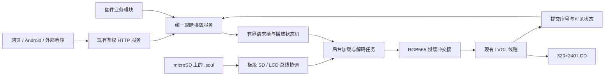

# ESP32-S3 三组眼睛显示与调用实施方案

> 状态：方案草案，2026-11-07。本文不代表功能已实现或已上机。
> 本轮仅新增本文档；不修改固件、资源、依赖或其他 agent 的工作，不执行编译、测试、刷机和设备操作。
> 后续实施者按任务逐项推进，可使用 `superpowers:executing-plans`；是否安排并行实现另行决定。

**目标：** 在 chan-X20A 的 S3 首页显示 v05、v14、v18 三组眼睛，提供统一的款式选择、表情播放、停止和状态查询接口，让固件模块、网页、Android 或外部程序无需理解图片格式即可调用。

**架构：** microSD 保存 `.soul` 文件，后台任务将当前款式的待机动画和当前效果载入有界缓存、解码为 RGB565；现有 LVGL 线程负责图像切换和页面管理。所有调用进入同一个播放服务，不让各业务模块直接操作屏幕或 SD。

**技术栈：** ESP32-S3、ESP-IDF **5.5.4**、现有 LVGL **9.4.0** / esp_lvgl_port **2.7.2**、FreeRTOS、现有 C++ `.soul` 解码器。保留 `dependencies.lock`、`repos.json` 和现有分区表。

**依据：** 用户本次要求、本文第 1–7 节设计、[已有资源说明](soul-eyes/v2-front/README.md)、[当前接入说明](../docs/soul-eyes.md)、[项目交接](../docs/session-handoff.md)、[验证记录](../docs/collector-validation.md)。源代码接入点为本次只读检查结果；其他 agent 正在工作，实施前应重读相关文件，以最新调用链为准。

## 1. 范围与默认选择

本方案先实现“可被明确调用的眼睛播放器”。以下是方案默认值，尚未成为设备配置：

- 每次只显示一组款式，三组共用相同的 30 个状态 ID。
- 新固件初始仍使用现有首页；调用者明确启用眼睛后，默认选 `v05` 并循环 `idle`。
- 款式与启用状态首版仅存 RAM，重启回到原首页。持久化设置可在后续明确需要时增加。
- 播放一次后回到当前款式的 `idle`；循环效果有最长 30 秒租期，不能永久占用屏幕。
- 保留摘要、日志、配对和 M12 页面、触摸导航、中心开关屏、现有爱心／叉号及提示音行为。
- 眼睛服务只负责显示，不调用舵机、不唤醒 M12、不启动情绪识别、不自动播放声音。现有上下遥控仍走当前俯仰控制逻辑。
- ASR 的爱心／叉号继续走原路径；映射为新眼睛效果属于后续业务选择，不在接入时偷偷替换。

## 2. 已有资源与容量

资源根目录：[soul-eyes/v2-front/](soul-eyes/v2-front/README.md)。

| 款式 ID | 外观 | 动画数 | PNG 帧数 | `.soul` 总字节数 |
| --- | --- | ---: | ---: | ---: |
| `v05` | 金瞳正面猫眼 | 30 | 240 | 3,103,424 |
| `v14` | 绿色圆角机甲眼 | 30 | 240 | 3,820,670 |
| `v18` | 奶油白眼白、黑瞳 | 30 | 240 | 3,460,594 |
| 合计 | 三款均为正面 | 90 | 720 | 10,384,688 |

以上数量和大小来自当前文件及 [manifest.json](soul-eyes/v2-front/manifest.json)。帧尺寸统一 **320×240**；每段 8 帧，按各帧独立时长播放，当前单帧时长为 **70–1000 ms**，不能简单统一成固定 FPS。

设备使用 `sdcard/soul/<style>/<state>.soul`。PNG、GIF、MP4 和交互 HTML 供制作、预览与验收，不需要全部复制进设备。

现有 Flash `assets` 分区只有 **4 MiB**，完整三组约 **9.90 MiB**；直接放入当前资源分区不可行。也不能覆盖现有资产或扩大分区挤占应用槽。

| 路线 | 适用性 | 本方案选择 |
| --- | --- | --- |
| microSD + 有界内存缓存 | 容纳全部三款，可离线运行；需要新增 SD 与 LCD 总线协调 | **首选** |
| 将少量动画编入应用 | 可做无卡时的小样或静态兜底；需另外核对应用槽余量 | 暂不新增，沿用原首页兜底 |
| 改 Flash 分区／覆盖资源分区 | 涉及现有资产和部署边界 | 不采用 |
| 网络持续推送图片 | 引入断网、延迟和带宽依赖 | 不作为首版显示路径 |

首选路线以“设备装有可读 microSD”为实施前提；本轮没有读取设备、确认插卡或验证卡速。

## 3. S3 显示实现

### 3.1 数据流与所有权



职责边界：

- **板级存储层**：唯一挂载 SD，协调 LCD 与 SD 的共用引脚；以后语音文件也复用这一层，不再各自初始化 SPI。
- **播放服务**：校验 ID、控制抢占、过期和取消，维护状态快照；不直接绘图。
- **后台任务**：读取文件、核对资源、解码、计算实际像素变更范围；不调用 LVGL。
- **LVGL 适配层**：创建图像对象、交换已完成的帧、执行刷新与旧缓冲释放；不读 SD、不解码。
- **业务调用者**：表达“播放什么”，不提交路径、像素指针或文件描述符。

### 3.2 必须先解决：LCD 与 SD 共用总线及 GPIO35

当前 `hal/board/stackchan.cc` 的 `InitializeSpi()` 只配置 LCD：`SPI3_HOST`、MOSI=37、SCK=36、MISO 未连接；LCD 使用 CS=3、DC=35。

官方 CoreS3 引脚表及 StackChan SD 示例给出的 SD 引脚为 CS=4、SCK=36、MOSI=37、MISO=35。即 **GPIO35 同时承担 LCD 的 DC 输出和 SD 的 MISO 输入**。[CoreS3 引脚表](https://docs.m5stack.com/en/core/CoreS3#pinmap)、[StackChan SD 示例](https://docs.m5stack.com/en/arduino/stackchan/sdcard)

因此不能只添加一次 `esp_vfs_fat_sdspi_mount()`，也不能让两个 SPI host 同时驱动相同物理线。普通 SPI 设备锁不自动解决 DC/MISO 的引脚方向交接。下面的板级协调是本方案设计，尚未实机验证：

1. 由板级代码统一初始化同一 SPI 总线；启用 SD 功能时，在 LCD 开始通信前完成 SD 的 SPI 模式初始化，其他设备 CS 保持空闲。采用 `format_if_mount_failed=false`，不自动格式化卡。[ESP-IDF 5.5.4 / ESP32-S3 总线共享初始化要求](https://docs.espressif.com/projects/esp-idf/en/v5.5.4/esp32s3/api-reference/peripherals/sdspi_share.html)
2. 建立同时覆盖 LCD 命令／颜色传输和所有 SD 文件访问的板级协调器。进入 SD 阶段前暂停新的 LCD 事务，等待已排队 LCD DMA 真正完成，保持 LCD CS 空闲，然后将 GPIO35 交给 SD 输入。
3. SD 操作结束后，确保 SD CS 已释放，恢复 GPIO35 的 LCD DC 输出配置，再允许 LCD 发起下一批事务。成功、读错、超时、取消都走同一释放路径。
4. 初始按每次最多 4096 字节的文件读取段交接，段间允许显示继续；底层实际事务时长仍需测量。文件打开、查表、关闭及 FAT 元数据读取也受协调，不能只保护 `fread()` 的数据段。
5. 统一锁顺序，SD worker 不持 LVGL 锁；DMA 完成回调只发通知，不获取阻塞锁。不在持有某个 SPI 设备独占锁时再调用可能重复取锁的 VFS/SDSPI API。
6. 新增 SPI/SD 相关驱动初始化沿用项目中断约束，放到核 1 的初始化上下文；不把已有 LCD SPI 驱动卸载后重新安装。无卡或挂载失败应结束尝试并继续原首页启动。

第一阶段必须单独验证该协调器；如果出现花屏、卡读错或启动阻塞，先停在存储层排查，不能用不断重试读卡掩盖问题。首版只支持开机前插卡，不自动热插拔重挂载、不循环全盘扫描。

### 3.3 文件布局与格式校验

卡内布局保持资源包现状；`/sdcard` 是拟新增挂载点，目前不能当作已存在：

```text
microSD 根目录/
└── soul/
    ├── v05/idle.soul、happy.soul、…
    ├── v14/idle.soul、happy.soul、…
    └── v18/idle.soul、happy.soul、…
```

运行时路径由编译生成的白名单拼出：`/sdcard/soul/<style>/<state>.soul`。从现有 manifest 生成固定资源目录，包含 ID、文件大小、SHA256、帧数和时长；运行时不解析整个 JSON，不接受用户传入路径或 URL。

复用 [decoder/soul_animation.h](soul-eyes/v2-front/decoder/soul_animation.h)：

- `soul::Reader` 提供 `size()` / `readAt()`；首版以载入缓存后的 `MemoryReader` 为解码输入。
- `soul::Animation::open()` 校验 `SOULAN1` 头、版本、尺寸、帧表、文件大小及范围。
- `decode()` 产生数值 RGB565，并检查每帧 CRC、像素数及 RLE 边界；只有 `soul::Error::Ok` 的完整帧能发布。
- 每次从卡载入文件后核对大小及 SHA256，与固件目录匹配后才使用。CRC 用于逐帧检测，不替代资源版本匹配。
- 文件缺失、版本不匹配或损坏均记录明确错误；不自动下载、重写卡或退回任意同名文件。

### 3.4 缓存和内存预算

优先“按动画加载，再从 RAM 解码”，避免每一帧都与 LCD 争 SD。当前最大单段动画为 **208,476 字节**；每个压缩缓存上限取 **256 KiB**，只缓存当前款式 `idle` 和当前效果，不缓存全部三款。

| 新增部分 | 预算 | 分配与用途 |
| --- | ---: | --- |
| 两个 RGB565 完整帧 | 307,200 B | PSRAM；前台显示帧和后台待交接帧 |
| 两个压缩动画槽 | 524,288 B | PSRAM；当前 `idle` + 当前效果，每槽 256 KiB |
| 解码输入 scratch | 4,096 B | 普通字节缓冲，作为解码器参数 |
| 以上合计 | 835,584 B，约 816 KiB | 不包括下列额外开销 |
| 元数据、队列、worker 栈、SD/FAT/DMA 缓冲 | 实施时单列 | 部分需要内部 RAM；不能以 PSRAM 空闲量替代 |

必须额外统计现有 LVGL 图像缓存、320×20 的 LCD DMA 绘制缓冲、旧首页缓冲、爱心／叉号缓存、JPEG 和音频队列。标称 PSRAM 容量不能直接当作可用预算。

首版保留旧首页资源用于回退，不为了眼睛预先删除已有缓存。内存不足时保持原首页，报告 `no_memory`，不抢占音视频缓冲。

切换款式先取消当前效果，在空出的效果槽载入新款式 `idle`；校验和首帧准备成功后再交换两个压缩槽的角色、提交新款式。失败保留旧款式，不出现“选中 v14、实际仍是 v05 却无错误”的状态。更换普通效果时保持当前已提交帧，复用效果槽加载新文件；取消旧请求后不再从旧槽解码。

### 3.5 LVGL 接入与缓冲生命周期

在 `collector/screen.cpp` 的 `home` 下增加独立眼睛图像对象，位置 **(0,0)**、尺寸 **320×240**。现有笑面男对象为 (30,0)、260×240；两者按当前首页模式切换可见性，不能直接沿用旧图像偏移。

沿用 `collector.cpp` 的 20 ms LVGL timer 和现有锁；眼睛准备未完成时 timer 立即返回。后台 worker 初始采用低优先级、核 0，与 JPEG 核 1 分开；等待通知或至少等待一个 FreeRTOS tick，不能空转。具体栈大小和优先级在实现时根据实测调整。

缓冲交接约定：

1. worker 只写 `FREE/DECODING` 缓冲，完成解码后发布 `{generation, frame_index, buffer_index, due_ms}`，此后不再修改。
2. LVGL timer 重查 generation、显示开关和页面，再将 `READY` 缓冲设为图像源；描述符与像素内存都是服务级长期对象，不能是栈变量。
3. 旧显示缓冲进入 `RETIRING`。在与本次交换对应的 LVGL 刷新周期结束、确认所有绘制任务不再读取旧源图后，才通知 worker 复用；不能 `lv_image_set_src()` 后立即覆盖旧帧。
4. 当前 port 将源像素复制到内部 20 行 DMA 缓冲，LCD DMA 不应直接引用眼睛 PSRAM 源图。实施者需沿本地 LVGL/port 调用链确认这一条件及释放事件；`LV_EVENT_REFR_READY` 可作为待核对的源图读取结束点，不能宣传为物理像素已显示。SD 总线切换仍单独等待 DMA 完成。
5. 对隐藏、停屏、销毁和取消设置明确的排空路径：已绑定源仍保留，未绑定帧可丢弃；不等待一个已被暂停的刷新事件才能取消请求。

解码器输出 RGB565 数值，沿用现有显示 port 的 `swap_bytes=1`。不再添加 Arduino 的 `setSwapBytes(true)` 或额外交换，避免颜色颠倒。

首版先做正确的完整帧替换；全屏单帧原始像素为 153,600 B，在现有 40 MHz SPI 下纯像素传输理论下限约 30.72 ms，实际还包含绘制、命令和总线竞争。该估算不是实测帧率。稳定后再基于相邻解码帧的真实像素差生成脏矩形，保留眨眼、光晕和跨款式变化，不能复用笑面男文字环的固定区域。

### 3.6 时序、页面和旧反馈共存

- 首帧交给 LVGL 后建立单调时钟时间线，后续按 `.soul` 帧时长累加 deadline；不能每次按“当前时刻 + duration”累积漂移。
- worker 预解码下一帧；如果晚于计划，记录 lateness，跳到当前应显示的帧，不高速补播积压帧。所有帧为独立完整图像，可直接跳帧。
- `once` 按文件时长结束，返回当前款式 `idle`；`loop` 按调用者指定租期结束。`completed` 表示软件时间线结束，不证明用户看到了每帧。
- 熄屏或离开首页：立即取消当前／等待效果、递增 generation，停止眼睛解码和刷新。恢复首页后从 `idle` 首帧开始，不补播离开期间的效果。
- 现有爱心／叉号优先。显示它们时取消眼睛效果并隐藏眼睛图像，保持原反馈区域外为黑色；反馈结束后回 `idle`。不要让旧 260×240 覆盖层之外残留眼睛边缘。
- 播放请求不能切页、亮屏或打断 M12 页面；不满足显示条件时返回 `not_visible`，不积压等待。
- configure 可在其他页面或熄屏时更新款式／启用意图，但不得因此显示首页；可见后才恢复相应首页模式。

## 4. 给固件开发者的接口约定

**以下接口均为拟新增，不是现在可调用的 API。** 公共头文件计划为 `main/collector/eyes/eyes.h`；业务代码只引用它。

```cpp
namespace collector::eyes {
enum class Style { V05, V14, V18 };
// State 由资源目录生成，覆盖第 6 节全部 30 个状态，例如 Idle、Happy、Thinking。
enum class Operation { Configure, Play, Stop };
enum class Mode { Once, Loop };
enum class Source { Manual, Voice };  // HTTP 固定映射 Manual，不接受外部指定优先级。

struct Command {
    char request_id[37]{};           // 非空 UUID；submit 必须复制，不保存调用者指针。
    Operation op = Operation::Play;
    bool enabled = false;            // Configure 使用。
    Style style = Style::V05;        // Configure 使用。
    State state = State::Idle;       // Play 使用；采用当前已成功应用款式。
    Mode mode = Mode::Once;
    uint32_t loop_for_ms = 0;        // Once 必须为 0；Loop 为 1000–30000。
};
struct SubmitResult {
    bool accepted;
    uint32_t request_seq;            // 仅本次 boot 有意义；拒绝为 0。
    const char* error;               // 静态错误码；成功为 nullptr。
};

SubmitResult submit(const Command& command, Source source);
Snapshot snapshot();                // 拷贝返回第 5.3 节字段，无内部裸指针。
}
```

`State` 和 `Snapshot` 在实施时提供真实定义，不能只保留前置概念；枚举与 JSON 使用固定映射，如 `State::Happy ↔ "happy"`。上述代码展示公共契约，不是一份现在能编译的头文件。

三种操作语义：

| 操作 | 行为 |
| --- | --- |
| `Configure(enabled=true, style=V14)` | 验证资源、准备新 `idle`，成功后启用该款式；不切页、不点亮屏幕 |
| `Play(state=Happy, mode=Once)` | 用当前款式播放开心一次；结束回 `idle` |
| `Play(state=Thinking, mode=Loop, loop_for_ms=5000)` | 思考循环最多 5 秒；可被新请求、停止或页面切换终止 |
| `Stop` | 取消本服务内效果和等待请求，保留已选款式，回 `idle`；不会取消旧爱心／叉号 |
| `Configure(enabled=false, style=...)` | 取消眼睛工作并恢复原首页；禁用时不读所选款式文件 |

调用示意：初始化 `Command`、填入唯一 `request_id`，设置 `state=State::Happy`，调用 `submit(cmd, Source::Manual)`。收到 `accepted=true` 后，通过快照观察请求是否实际提交到显示层；业务线程不等待播放结束、不持 LVGL 锁调用、不在 ISR 中调用。

仲裁规则固定为：原有爱心／叉号和页面控制 > Manual > Voice > idle。同优先级的新效果替换旧效果；低优先级不能抢占高优先级效果，返回 `busy`。首版仅有一个当前请求和一个“最新待处理请求”槽，不积累播放列表。

所有 accepted 请求分配新序号；从接收起 **1500 ms** 内未能首次提交显示的 Play 请求变为 `expired`。加载结束、排队消费和 LVGL 提交三个位置均检查 generation／过期条件。`Stop` 和禁用应立即使旧 generation 失效，慢文件读取结束后也不能复活旧效果。

配置切换期间拒绝 Play 并返回 `busy`，避免调用者不知道采用新款式还是旧款式。配置加载失败时保留旧已应用配置，状态同时显示本次失败；请求的配置与已应用配置分开记录。

## 5. 给网页、Android 和外部程序的协议

### 5.1 拟新增 HTTP 入口

复用当前设备身份挑战、Bearer 鉴权和主 HTTP 服务，不另开端口。新增：

| 方法与路径 | 用途 |
| --- | --- |
| `GET /v1/eyes` | 返回能力版本、款式、30 状态、播放模式和参数范围 |
| `GET /v1/eyes/status` | 返回当前快照和最近请求结果；可用 `request_id` 查询有界历史 |
| `POST /v1/eyes` | 明确配置、播放或停止 |

三个入口都需鉴权；POST 强制匹配 `X-Boot-Id`，JSON 正文上限 **384 字节**，严格类型与字段白名单。保留原鉴权失败处理，不允许任意路径、URL、文件上传或自定义优先级。

现有主服务约有 10 个 URI handler、配置上限为 12；新增后需要同步将 `max_uri_handlers` 提到至少 **16**，并按实施时实际注册数复核。无需因此增加 socket 上限或启动新服务。

以下是 **未来请求示例，当前未实现，不能现在直接发送**。公共文档只使用占位身份，不写真实 token/IP。

```http
POST /v1/eyes
Authorization: Bearer <TOKEN>
X-Boot-Id: <CURRENT_BOOT_ID>
Content-Type: application/json

{"op":"configure","request_id":"<UUID-1>","enabled":true,"style":"v14"}
```

等待配置状态已应用后，播放一次：

```json
{"op":"play","request_id":"<UUID-2>","state":"happy","mode":"once"}
```

有限循环及停止：

```json
{"op":"play","request_id":"<UUID-3>","state":"thinking","mode":"loop","loop_for_ms":5000}
```

```json
{"op":"stop","request_id":"<UUID-4>"}
```

外部 Play 不带 style，统一使用已经应用的款式；切款先 configure。`once` 禁止附带 `loop_for_ms`；`loop` 必须给出 1000–30000 的整数。configure 必须同时给 enabled 和 style；stop 不接受额外业务字段。未列出的字段、状态或类型返回 400。

### 5.2 接收、去重和错误

通过同步校验并入槽后返回 HTTP **202**，例如：

```json
{"accepted":true,"request_id":"<UUID-2>","request_seq":42,"status":"accepted"}
```

202 只表示接受，不表示已经显示。按 `(boot_id, request_id)` 保留最近 **16** 条请求、最多 **60 秒**；同 ID、相同规范化内容返回原结果，不重新播放；同 ID、不同内容返回 409。过期或被淘汰后查询返回 `request_unknown`；客户端不能将该结果解释为“从未执行”，也不能据此自动重发。

| 情况 | 同步拒绝／异步结果 |
| --- | --- |
| 参数、状态、类型不合法 | 400 / `invalid_argument` |
| 正文超限 | 413 / `body_too_large`，沿现有方式终止该请求体 |
| 未鉴权 | 沿现有 401 行为 |
| boot 失配、未启用、非首页／熄屏、低优先级抢占 | 409 / `boot_mismatch`、`disabled`、`not_visible`、`busy` |
| 已知无卡／无内存／存储未就绪 | 503 / `storage_unavailable`、`no_memory` |
| 接受后文件缺失、校验失败、读卡失败 | 请求 `failed`，附 `asset_missing` / `asset_invalid` / `io_error` |
| 首次显示超时、被替换、页面离开 | `expired` / `cancelled`，附具体原因 |

断线或响应超时按“结果未知”处理，只读取状态，不自动重发。旧 boot 的请求不能在新 boot 重放。

### 5.3 状态字段与含义

`GET /v1/eyes/status` 和 `/v1/telemetry` 的 `eyes` 子对象使用同一快照，不各维护一份状态：

| 字段 | 定义 |
| --- | --- |
| `supported`, `ready`, `enabled` | 固件支持、资源/内存可用、已应用启用意图；三者分别表示 |
| `requested_style`, `selected_style`, `active_style` | 最近配置请求、成功应用款式、当前绑定帧款式；无眼睛源时 active 为 null |
| `state`, `mode`, `source` | 当前效果、播放模式和来源；非播放时明确为 idle 或 null |
| `phase` | `legacy/loading/idle/playing/suspended/error` |
| `visible`, `suspended_reason` | 软件页面/显示门控结果；不等于物理亮度测量 |
| `generation`, `frame_index`, `submitted_seq`, `rendered_seq` | 取消代次、已提交帧索引、LVGL 提交序号、确认结束渲染的序号 |
| `last_request` | ID、序号、操作、`accepted/presenting/completed/cancelled/expired/failed`、原因 |
| `last_error` | 最近错误码及相应请求序号；没有错误为 null |
| `stats` | 读卡/解码耗时、迟帧/跳帧/错误计数、内存占用及内部 RAM 最低余量 |

`Snapshot` 是上述信息的有界 C++ 值类型，字符串使用固定容量数组或枚举映射；HTTP 序列化不持播放服务锁做网络发送。查询某个 request_id 时返回其保存结果，未找到明确返回 unknown；不能用 last_request 代替所有历史请求。

### 5.4 网页和其他人的调用方式

- **网页观察台**：在现有 `/api/control` 白名单增加 `eyes_configure`、`eyes_play`、`eyes_stop`，由本机服务转发设备 `/v1/eyes`；继续使用同源检查、最新 boot 和私有配对配置。页面提供启用、三款选择、30 状态选择、播放一次、停止及结果文字。
- **Android／外部客户端**：先走已有身份验证，读取能力和 boot，再显式配置／播放。调用者只需要 style/state ID，不接触 `.soul` 或 LVGL。旧固件不支持时禁用入口。
- **本地固件业务**：调用第 4 节公共接口。未来语音播放模块可传入 `Source::Voice`，但首版不自动订阅 ASR/M12/情绪事件。
- 页面打开、刷新、重新连接、恢复前台只读取状态，不自动启用或重播上次表情。控制结果显示“已接收”“显示层已提交”“已取消／失败”，不把 202 文案写成“播放成功”。

## 6. 可调用效果清单与语音映射

三款使用完全相同的状态 ID：

| 状态 ID | 中文 | 状态 ID | 中文 | 状态 ID | 中文 |
| --- | --- | --- | --- | --- | --- |
| `idle` | 待机 | `greeting` | 迎接 | `surprised` | 惊讶 |
| `happy` | 开心 | `grateful` | 感谢 | `confused` | 困惑 |
| `hurt` | 扎心 | `apologetic` | 歉意 | `thinking` | 思考 |
| `sad` | 伤心 | `comforting` | 安慰 | `expectant` | 期待 |
| `angry` | 愤怒 | `encouraging` | 鼓励 | `curious` | 好奇 |
| `affectionate` | 亲密 | `determined` | 坚定 | `shy` | 害羞 |
| `laughing` | 嘲笑 | `refusing` | 拒绝 | `worried` | 担忧 |
| `goofy` | 搞怪 | `pleading` | 恳求 | `scared` | 害怕 |
| `sarcastic` | 嘲讽 | `relieved` | 释然 | `sleepy` | 困倦 |
| `helpless` | 无奈 | `farewell` | 告别 | `proud` | 得意 |

已有 [candidate-animation-map.json](soul-eyes/v2-front/voice-coverage/candidate-animation-map.json) 为 300 个语音候选提供 `primary_animation` 和 `alternates`，涵盖 20 个主题。需要语音联动的调用者可按下面流程使用：

1. 用实际语音候选 ID 查询映射；例如当前 `QT-001` 的主动画为 `proud`。
2. 将 `primary_animation` 验证为合法状态；未映射时只维持 idle，不猜测外部自由文本。
3. 在语音实际开始播放的业务事件处提交 Voice 请求；不能把“下载完毕／入队”当作声音已经开始。
4. 语音被取消时，只取消仍属于该语音请求的眼睛效果；不能用无条件 Stop 覆盖后来接管的 Manual 请求。后续语音适配需提供带 request_seq 的条件取消接口。

这些映射仍是建议，原声听感尚未逐句核对；资源包不包含声音。首版只交付通用显示能力，不承诺音画精确同步。

## 7. 故障与退回行为

| 场景 | 期望行为 |
| --- | --- |
| 未插卡或启动挂载失败 | 原首页正常启动；报告存储不可用，不格式化、不持续重试 |
| 单段效果缺失／损坏 | 拒绝该效果或标 failed；当前款式 idle 可用时回 idle |
| 新款式 idle 无法加载 | 切换失败，保留旧已应用款式；首次启用失败则保留原首页 |
| 播放中发现 CRC/解码错误 | 不发布半帧；终止该效果，尝试已缓存 idle；idle 也失败则回原首页 |
| SD 读错／卡被拔出 | 当前已验证 RAM 动画可继续；下一次加载失败后标记存储不可用，禁止自动重挂载 |
| 内存分配失败 | 不启用眼睛，释放未绑定资源，保留原显示和采集 |
| 停屏、切页、爱心／叉号 | 取消眼睛效果并释放未展示任务；恢复时只回 idle |
| 关闭眼睛 | 排空后台发布与 LVGL 引用后回原首页；保留原导航和中心开关屏逻辑 |

## 8. 文件分工与实施顺序

路径以仓库根为基准。下列是**未来修改清单**，本轮均不创建、不修改、不运行。实施者先协调其他 agent 正在改动的文件，尤其 `collector.cpp`、`screen.cpp`、板级存储与语音模块；不要复制第二套 SD 管理器。

| 文件／目录 | 计划职责 |
| --- | --- |
| `scripts/prepare-eyes-catalog.py` | 从 manifest 生成固件白名单、校验值和 State 映射 |
| `upstream/StackChan/firmware/main/collector/eyes/catalog.generated.h` | 只读资源目录，不嵌入整套动画 |
| `upstream/StackChan/firmware/main/collector/eyes/eyes.h/.cpp` | 公共契约、线程安全请求、状态快照 |
| `upstream/StackChan/firmware/main/collector/eyes/player.h/.cpp` | 可用假时钟测试的播放、抢占和取消逻辑 |
| `upstream/StackChan/firmware/main/collector/eyes/loader.h/.cpp` | 缓存、SHA256、MemoryReader 与解码 worker |
| `upstream/StackChan/firmware/main/collector/eyes/view.h/.cpp` | LVGL 图像对象、页面门控、帧交接和释放 |
| `upstream/StackChan/firmware/main/hal/board/shared_storage.h/.cc` | SD 挂载、文件读取与 LCD/SD 共用总线协调 |
| `upstream/StackChan/firmware/main/hal/board/stackchan.cc` | SD/LCD 初始化顺序和板级引脚接入 |
| `upstream/StackChan/firmware/main/hal/board/stackchan_display.cc` | 所有显示传输纳入协调，提供实际 DMA 完成边界 |
| `upstream/StackChan/firmware/main/collector/screen.cpp`、`screen.h` | 首页模式切换、旧反馈和页面门控挂接 |
| `upstream/StackChan/firmware/main/collector/collector.cpp` | HTTP 适配、能力、遥测和 timer 挂接，不放解码逻辑 |
| `upstream/StackChan/firmware/main/CMakeLists.txt` | 登记新增源码与现有解码头路径；按需声明 IDF 自带 SD 组件 |
| `web/monitor/control.mjs`、`public/control-ui.js` 及现有页面 | 手动控制入口与请求结果 |
| `tests/test_eyes.py`、`tests/eyes_player_test.cpp`、`tests/eyes_loader_test.cpp` | 主机协议、调度、缓存、错误处理 |
| `tests/display/`、`web/monitor/*.test.mjs` | 显示生命周期、旧页面和网页显式点击回归 |

### 阶段 1：资源目录与板级存储

- [ ] 固定三款／30 状态白名单，生成目录并确保不存在任意路径输入。
- [ ] 实现唯一 SD owner 与 LCD 协调；在启用首版功能前明确引脚方向、锁顺序、DMA 排空和无卡退出路径。
- [ ] 先验证正常读取、无卡、坏文件和读错恢复；记录显示与 SD 交替时序。此阶段不替换首页。
- [ ] 验收产物：可按资源 ID 读取并验证指定文件；缺卡不影响原机启动，无 GPIO35 同时驱动冲突。

### 阶段 2：播放器和内存交接

- [ ] 按第 4 节定义公共接口和 Snapshot，落实当前槽／等待槽、generation、1500 ms 首帧期限和优先级。
- [ ] 用假 Reader／假时钟覆盖请求替换、过期、Stop 后迟到加载、帧跳过、循环租期及配置失败保留旧款式。
- [ ] 实现两个压缩槽、两个帧缓冲、CRC/SHA256 检查；未释放源帧不能再次写入。
- [ ] 验收产物：不接 LCD 也能判断某时刻应显示哪一帧、何时取消、哪个缓冲可写。

### 阶段 3：接入现有首页

- [ ] 挂接 LVGL timer 与页状态，加入 320×240 眼睛对象及旧首页回退。
- [ ] 覆盖显示关闭、页面离开、爱心／叉号遮挡、恢复 idle、颜色字节序和缓冲引用释放。
- [ ] 在主机显示夹具中检查三款首帧、状态切换和 30 状态；源帧视觉检查不能替代 S3 刷新验收。
- [ ] 验收产物：显式启用后能显示眼睛，禁用回原首页；触摸、M12 页面及中心开关屏行为保持。

### 阶段 4：公开调用接口

- [ ] 增加三个 HTTP handler、鉴权／boot／正文限制与有界去重，核对 URI 注册容量。
- [ ] HTTP 与固件内部调用共用 submit，不出现独立的第二套播放状态。
- [ ] 网页白名单加入三种眼睛操作；打开、刷新、重连不发动作。
- [ ] 覆盖错误类型、未鉴权、旧 boot、未知 ID、同 ID 不同内容、超大正文、超时结果未知和状态查询。
- [ ] 验收产物：其他人只凭第 4–6 节即可配置款式、播放／停止和解释返回值。

### 阶段 5：未来构建与实机验收

- [ ] 资源校验与现有 decoder 主机测试使用 [已有命令](../docs/soul-eyes.md#6-校验资源与解码器)，新增主机用例纳入 `python3 -B -m unittest discover -s tests -v`。
- [ ] 扩展并运行 `tests/display/` 和网页现有 Node 测试，核对旧首页／控制路径；检查生成目录和实际资源一致。
- [ ] 后续固件构建仅用 `./scripts/idf.sh build`，不升级工具链和依赖；保留现有分区。
- [ ] 实机部署仍先核对身份、活动分区和完整旧槽备份，仅按本项目规则写应用并独立校验；资源单独复制到明确目标 SD，不把全盘格式化作为安装步骤。
- [ ] 三款各检查中性、开心、思考、拒绝、眨眼时序和切款，再覆盖全部状态；分别记录视觉、软件帧序号及实际显示延迟。
- [ ] 在相机、麦克风、IMU、网页观察并发时，进行原首页／眼睛的等时长对照，记录音视频序号缺口、队列丢弃、JPEG 结果率、UI 耗时、SD/解码耗时、内存低水位与温度；初始目标各 60 秒，并报告差值。
- [ ] 对 70 ms 短帧量化 lateness 和跳帧；以持续播放无撕裂／花屏、无新增采集丢失、触摸与关屏及时为验收目标。未达标先优化脏矩形／读取分段／解码，不擅自降低采集需求来掩盖开销。
- [ ] 本功能验收不需要自动反复驱动舵机。负载抖动问题仍独立处理，不能把眼睛播放成功称作整机稳定。

## 9. 重点复核清单

这些条件必须进入相应阶段的测试，不能只演示正常播放：

1. **SD 与 LCD 共用 GPIO35，且已有 LCD DMA 未完成**：阶段 1 验证互斥与恢复，无卡分支也能正常显示。
2. **读文件期间收到停屏／Stop／新请求**：阶段 2 验证旧 generation 永不发布，首帧超时不迟到补播。
3. **LVGL 仍引用旧缓冲，或熄屏导致无后续刷新**：阶段 3 验证无覆盖／悬空引用，取消不会等死。
4. **M12 页面／爱心叉号覆盖／恢复首页**：阶段 3 验证没有残留边缘、自动切页或旧效果重放。
5. **响应丢失、重启和重复请求**：阶段 4 验证不重复播放、旧 boot 拒绝、未知结果不自动重发。

## 10. 本轮交付边界

本文完成设计与实施分解。SD 共用总线适配、运行时播放器、C++/HTTP 接口、网页入口均尚未实现；本文列出的构建、测试与实机检查都是未来工作，本轮未执行。

后续建议先推进阶段 1 的板级存储与显示共存验证，再推进播放器和公开接口。现有资源已经够用，首版无需重新制图或引入 Arduino 播放工程。
