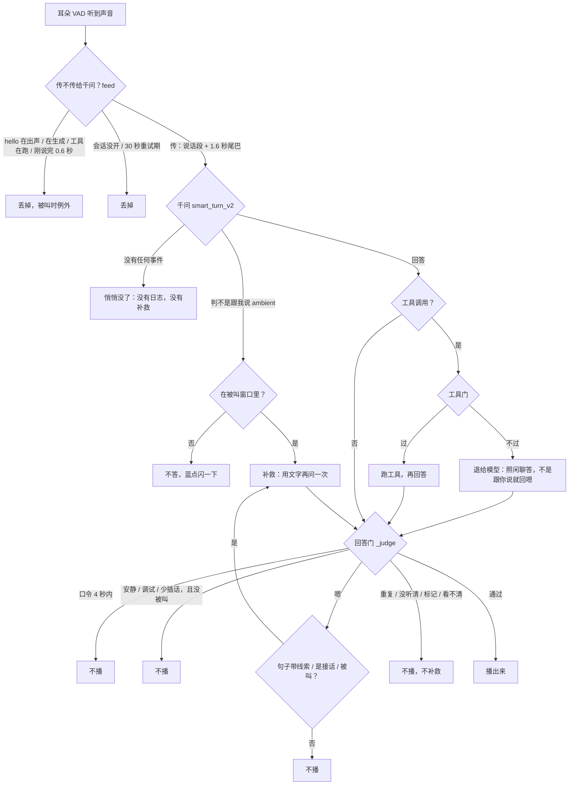

# 架构审计：服务器（耳朵 + mind），重点是受话判断（2026-11-19，Fable）

只读审计：没改代码，没部署，没花钱。数据来自运行日志（Mongo `hello.log_202611`，只读查询），主要看 11-18 和 11-19 两天，也就是千问 smart_turn_v2 打开之后。

代码行号按提交 `4faf2f3`（`server/ear/realtime_link.py`、`server/ear/rt_base.py`）。今晚还在拆文件，行号会变，函数名不变。

口径说明：日志里没有「这句话是不是跟 hello 说的」的真值。下面用四种代理：叫过名字或点过屏幕之后的话、hello 说完 20 秒内的接话、带「你…」的话、普通问句。「千问有没有判定」是按时间对的（句子开始到结束后 6 秒内有没有回答或「不是跟我说」的记录），会有少量错配，但差距大到不影响结论。

---

## 1. 一句话结论

漏答的主因不是哪道门太严，而是 **smart_turn_v2 打开以后，耳朵听到的话里约 80% 千问没有给任何判定**（不回答，也不说「不是跟我说」），而现在所有的补救都要等千问先给出一个判定才会启动，所以这些话悄悄没了，日志里也看不见。

第二个原因：「叫了就一定答」现在不是一个保证，而是散在十几处的检查。两天里 50 次叫它，有人接着说了话的 43 次里只答了 19 次，没答的 24 次分散在十来种不同的原因上。

建议：把受话判断收成耳朵里的一个「裁决器」。耳朵先判、再决定交不交给千问；千问的判断只当一条证据；「必答」由一个看门的统一兜底。

---

## 2. 受话判断：现在的样子

### 2.1 信号（证据）在哪

| 信号 | 在哪 | 现在怎么用 |
|---|---|---|
| 语音模块听到「hello」 | 机器人 → `called("asr")`，realtime_link.py:319 | 开 10 秒「被叫」窗口（`CALLED_S`，rt_base.py:269） |
| 关键词耳朵听到 Dynames | `kws_link.py` → `called("name")`（ear_server.py 里接线） | 同上。两天只命中 5 次，差一点的 61 次 |
| 句子开头是 hello / Dynames | `call_rest` → `_heard_text`，realtime_link.py:1998 | 同上，并记下 `_called_text`（2.5 秒没人答就补问） |
| 点屏幕 | `touched()`，realtime_link.py:454 | 20 秒「必答」窗口（`TOUCH_S`） |
| 千问 smart_turn_v2 | `Config.turn`，rt_base.py:892；事件处理 realtime_link.py:1693 | 判「不是跟我说」就不回答，只来一条 ambient 记录 |
| 人设里的「嗯」规则 | rt_base.py:145 | 让模型自己判断，不是跟它说就只回「嗯」 |
| 回答门 | `reply_verdict` rt_base.py:214；`_judge` realtime_link.py:1821 | 嗯 / 没听清 / 重复 / 标记 / 看不清 → 不播 |
| 补救 | `_try_rescue` realtime_link.py:2091；`ADDRESS`、`is_question`、`FOLLOW_S` | 只在「嗯」之后 5 秒内、且句子带线索时再问一次 |
| 说话方式 | `quiet_on / low_on / debug_on`（rt_manner.py），在 `_judge` 开头 | 没被叫就不播 |
| 工具门 | `_tool_allowed` realtime_link.py:1023；`intent.py` | 被叫 / 规则词 / 分类器 / 同一条链才给用工具 |
| 口令词 | `ordered()` realtime_link.py:358；`ORDER_WORDS` rt_base.py:288 | 关掉被叫窗口，4 秒内不回答 |
| 声纹 | `local_heard` realtime_link.py:1971 | 只用在工具权限和身体门，不参与受话判断 |
| 人脸、脸朝着我（M12 look / look_end） | `vision_link.py`、`FaceView` | 只写进「你的眼睛」和日志，**不参与受话判断** |
| 11-17 的「受话融合」方案（P0–P5，打分表） | 只在观察台的 crowd-flow 页面和当时的讨论里 | **代码里没有**：没有打分函数，没有 `gate.addressed` 记录。只做了 P1 的「被叫」 |

### 2.2 先后和互相覆盖

要点：

1. **三道「拒」串联**：smart_turn → 人设的「嗯」→ 回答门。每一道都会错拒，错拒率是叠加的。
2. **「该答」的证据只能事后翻案**：名字、点屏幕、接话、带「你」，都不在前面参与判断，只在被拒之后触发补救，而且要多跑一轮模型。
3. **补救只挂在两个地方**：「嗯」之后（`_judge` 末尾，realtime_link.py:1893），和被叫窗口里的 ambient（realtime_link.py:1708 附近）。千问完全沉默时，只有「句子开头带 hello」这一种叫法有兜底（`_called_text`，realtime_link.py:2012 和 568）；语音模块叫、关键词叫、点屏幕都没有。
4. **两套耳朵各切各的句子**：耳朵自己的 VAD + 识别，和千问的 VAD + 转写，靠「前后 3 秒」这类时间窗对起来（realtime_link.py:1850、1896，`HEARD_EPS_S`）。谁先到不一定。

---

## 3. 受话判断：问题（按严重程度）

### 问题 1：smart_turn_v2 下，约 80% 的话千问没有任何判定，系统对此是瞎的

数据（耳朵听到、会话开着、hello 没在出声的句子）：

| 千问的断句方式 | 有判定的句子 | 比例 |
|---|---|---|
| 旧的 server_vad（11-16 到 11-18 上午） | 455 / 577 | 79% |
| smart_turn_v2，被叫窗口外 | 442 / 2630 | 17% |
| smart_turn_v2，被叫窗口内 | 28 / 61 | 46% |

按句子类型看结局（11-18、11-19）：

| 类型 | 句数 | 答了 | 千问没判定 | 判不是跟我说 | 嗯门 | 重复门 |
|---|---|---|---|---|---|---|
| 被叫 / 点屏幕窗口内 | 58 | 18（31%） | 20（34%） | 2 | 5 | 1 |
| hello 说完 20 秒内的接话 | 113 | 19（17%） | 48（42%） | 5 | 14 | 23 |
| 带「你…」线索 | 218 | 15（7%） | 145（67%） | 28 | 8 | 4 |
| 普通问句 | 152 | 3（2%） | 118（78%） | 9 | 14 | 4 |

后两类里有不少本来就不是跟它说的，但前两类基本都是。

旁证：「你看看…」这类话要等千问认了才开始看（`_release_vision`，realtime_link.py:2058）。两天 59 次没开成，其中 **54 次是「6 秒内没等到千问判定」**，只有 4 次是千问明确说不是跟它说。

为什么没判定，我没法确认（不能调模型）。最可能的原因：耳朵只在自己的说话段加 1.6 秒尾巴里上传音频（`feed`，realtime_link.py:255–293；`tail_s` rt_base.py:901），之后一帧都不传。smart_turn 觉得话没说完时要多等一会儿静音，但静音没传上去，这一轮就一直悬着，直到下一段声音进来，再并成一轮或被丢掉。证据是判定常常很晚：ambient 判定比耳朵这句话结束晚的时间，中位 1.5 秒，四分之一超过 3.6 秒，一成超过 8 秒。

另外，主人 11-18 定的是 smart_turn「先只显示判定，不当裁判」。实际上它被设成了千问的断句方式，它不认的话根本没有回答，等于成了最前面、最硬的一道门。

### 问题 2：「叫了必答」不是保证

两天 50 次叫它（12 秒内的连叫算一次）：

- 答了 19 次。
- 叫完没人说话 7 次。
- 有人说了话但没答 24 次。

点屏幕（今天新加的「必答」）：7 次里 2 次没人说话，其余 5 次 **一次都没答出来**。关键词叫 Dynames：4 次答了 1 次。

没答的 24 次，原因很分散（一次归一个主因，是按日志推的，有几次可能归错）：

| 原因 | 次数 | 代码位置 |
|---|---|---|
| 千问完全没判定，没人兜底 | 6 | 兜底只给「句首带 hello」：realtime_link.py:2012 |
| 会话或机器人连线断了（其中上游断开一次后 30 秒不重连，被叫、点屏幕也不行） | 4 | `_open` 开头，realtime_link.py:619；`retry_s` rt_base.py:913 |
| 自己的回答被「同一句话」晚到的识别结果打断 | 2–3 | `called()` 一律 `_interrupt`，realtime_link.py:327 |
| 被当成口令（语音模块在中文长句里听出一个英文口令词） | 2 | `ordered()` 会清掉被叫窗口，realtime_link.py:364 |
| 重复门（同样的问题再问一遍，回答一字不差，就不播） | 2 | `reply_verdict` 的 repeat，rt_base.py:214；15 分钟内都算，`recent_s` rt_base.py:925 |
| 补救的回答被「标记门」整句丢掉 | 1（连着两次） | `MARKER_RE` rt_base.py:211 |
| 千问拒绝（有人在说话）、工具链没出声、其它 | 6 | — |

每个原因都只有一两次，说明不是某个门槛的问题，是结构问题：「必答」这个承诺没有一个负责人，靠每道门自己记得查「是不是被叫了」（`in_called` / `_called_until` 在一个文件里出现 17 处）。

其中两个值得单说：

- **自己打断自己**。常见顺序：叫 hello → 说一句长话 → 千问已经在答了 → 耳朵自己的识别这时才出字，句首带 hello → `called("text")` → 把正在说的回答掐掉。今天 16:51 那次回答被掐，6 秒后才补上；16:38 那次工具被取消，没有下文。根源是第 2.2 节第 4 点：两套耳朵没有共同的「句子编号」。
- **上游断开后聋 30 秒**。16:59:52 上游断开，17:00:02 叫 hello 没反应，17:00:22 点屏幕才重新打开会话。5 次上游断开，间隔都是 30 秒。

答上的那些也慢：从最后一句说完到开始出声，中位 5.0 秒，九成在 7.8 秒内（多数走了工具）。普通闲聊回合是 0.6–1.1 秒。

### 问题 3：补救太弱、太慢、条件太窄

- 「嗯」被挡 155 次，只发起 22 次补救。155 次里 **104 次在判定那一刻耳朵还没出字**，没有句子可判。之后 5 秒内（`RESCUE_S`）要是又有人说话，补救直接作废（realtime_link.py:2095）。
- 补救发起 33 次，播出来 16 次。其余被重复门、看不清门、标记门、嗯门再挡一次，或千问回了空。
- 从被挡到补救出声：中位 6.8 秒，九成 15.6 秒。对话早就过去了。
- smart_turn 判 ambient 的不走补救（除非在被叫窗口里）。11-19 一天 140 条 ambient 里，17 条带明确线索，45 条有「你」，都没有第二次机会。
- 工具门挡回去以后，提示语里写着「不是跟你说的就只回嗯」（realtime_link.py:1103）。11 次挡回里 8 次模型就真的只回了「嗯」。这种「嗯」不算普通回合，不补救（realtime_link.py:1893 只认 `kind == "speech"`）。一句真要用工具的话，分类器没认出来，就成了沉默。

### 问题 4：重复门误伤正常对话

重复门是为了治电视剧里反复说同一句。但它不看有没有被叫，也不看对方是不是把问题又问了一遍。接话类句子里 20%（23 / 113）死在重复门。11-18 一天 213 次。人没听清再问一遍，这是最需要回答的时候。

### 问题 5：hello 刚说完的那几秒，耳朵是半聋的

机器人说完后「自己在出声」的标记还会保持约 2.7 秒。这段时间：

- 千问这边：靠 `robot_tail_s` 特例把音频传上去（realtime_link.py:271、295）。
- 耳朵这边：识别、声纹、关键词耳朵收到的全是零（ear_server.py 的 `on_audio`，约 560–606 行）。

所以最自然的接话（它刚说完马上回一句）没有耳朵自己的文字，也就没有句首叫名、没有分类器预装技能、没有声纹、没有补救用的句子。再加上说完后 0.6 秒完全不收音（`guard_s`），以及它说话和工具运行时不收音（除非叫它），「接话」这条最强的受话线索反而最弱。

### 问题 6：好用的证据没用上

- **脸朝着它**：35% 的句子开口时有脸朝着它，11% 是开口前后 1.5 秒内刚转过来的。完全没进判断。
- **声纹**：两天里只有 9% 的句子是「认得」，53% 是「不确定」。主人自己的声音在办公室常落在「不确定」（代码注释 realtime_link.py:1014 也写了）。作为「这是主人在说」的证据还不够稳，但「不确定且领先明显」已经能当弱证据，现在只用在身体门。
- **关键词耳朵**：命中 5 次（分数 0.41–0.50），差一点的 61 次集中在 0.51–0.55。门槛 0.50 很可能卡在边上。「差一点」加上别的证据（脸朝着、主人的声音）就够算一次叫，现在是只要没过线就完全不算。

### 问题 7（次要）：误答

没法精确算。上限参考：既没叫、不是接话、不带线索、不是问句的 2172 句里，播了回答的 39 句（1.8%），其中一部分是正常的。和漏答比，现在误答不是主要矛盾。但任何放宽都要在 11-15 那段电视剧录音上回放验证。

---

## 4. 受话判断：建议的架构

目标：一个地方判、说得清为什么、能调、能审、能用主人的标注学。

### 4.1 形状

**一张「句子卡片」，一个「裁决器」，一个「必答看门的」。**

1. **句子卡片**（耳朵的 VAD 切出来的每一句一张，用麦克风采样位置编号，全系统只认这一个句子编号）。上面记这一句的全部证据：
   - 叫过没有（哪种叫法，多久之前）、点过屏幕没有；
   - 关键词耳朵的分数（命中 / 差一点，在句子的哪里）；
   - 是不是接话（hello 说完多久）；
   - 文字线索（句首叫名、带「你」、问句、看 / 查 这类词）；
   - 谁在说（声纹档位）；
   - 脸（有没有人、是不是刚转过来、远近）；
   - 说话方式（安静 / 少插话 / 调试）；
   - 千问的看法（smart_turn 认不认、是不是只回了嗯）——**只是其中一条证据**。

2. **裁决器**：一个纯函数，输入句子卡片，输出四档之一和理由。
   - 必答：点屏幕、叫名字之后的第一句。
   - 该答：接话、带明确线索且有人朝着它或是主人的声音。
   - 看千问的：其余，交给千问自己判断，「嗯」规则只在这一档生效。
   - 不答：安静模式里没被叫、口令词等。
   
   权重放在一个配置表里（11-17 方案里的那张表可以直接当起点：名字 +60、接话 +30、脸 +20、问句 +10、带你 +10…）。每句话写一条 `gate.addressed` 日志：证据、每条的分、总分、档位、最后结局。

3. **必答看门的**：一个小状态机，只管一件事——「必答」和「该答」的句子，在限定时间内要么播出了回答，要么给了看得见的失败提示。它盯着结局，不管中间是哪道门出的事：
   - 千问 2 秒内没动静 → 用耳朵的文字直接问（把现在只给「句首 hello」的兜底推广到所有叫法）。
   - 回答被嗯门 / 重复门 / 标记门挡了 → 必答档直接放行或重问一次，不再过这些门。
   - 会话断了 → 立刻重连，不等 30 秒。
   - 实在不行 → 屏幕上一句「没听清，再说一遍」，而不是沉默。

4. **谁切句子、谁决定交不交给千问：耳朵**。两种做法，建议先做 A：
   - **A（现在的接口就能做）**：千问用回 server_vad（两天数据：79% 的句子有判定）。耳朵自己把关：开口时已经够「该答」的（被叫、点过、接话窗口、脸刚转过来、主人声音），音频照常实时上传；其余的先压在缓冲里，等耳朵自己的文字出来、裁决器打完分，再决定补传还是不传。不传的话千问根本不知道，也不花钱，电视剧自然不会被答。
   - **B（要先探一下千问支不支持）**：关掉千问的自动断句，由耳朵提交每一轮。最干净，但不确定这个模型支持。

### 4.2 分几步做，每步怎么验收

| 步 | 做什么 | 改不改行为 | 验收 |
|---|---|---|---|
| 0 | **先看见**。日志补三样：每句话耳朵传没传、为什么没传；千问的「开始说话 / 说完」事件；裁决器影子打分（只记不管）。观察台加一张「漏答漏斗」：每天必答 / 该答各多少句、答了多少、死在哪。 | 不改 | 每条 `heard.asr` 都有且只有一条 `gate.addressed`；「千问没判定」的句子都能说清是没传、没断句、还是被丢了 |
| 1 | **止血：必答看门的**。包括：所有叫法都有 2 秒兜底；被叫 / 点屏幕时不受 30 秒重试限制；同一句话晚到的识别结果不再打断自己的回答（按句子编号去重）；必答档不过重复门，标记只剥掉不整句丢；口令词在长句里不算口令；工具门挡回后的「嗯」也能补救。 | 改，范围只限被叫 / 点屏幕之后 | 回放 + 实机：叫了且有人说话的，回答率 ≥ 90%（现在 44%）；到出声九成 ≤ 4 秒；点屏幕后 5 / 5 能答 |
| 2 | **弄清「没判定」**。用今晚已经批的离线回放（1 美元以内）在同一批录音上比三种配置：现在的；smart_turn + 一直传（含静音）；server_vad。只比「有判定的句子比例」和判定时延。 | 不改线上 | 选出覆盖率 ≥ 75% 的配置；选不出就定用 server_vad + 自己的裁决器 |
| 3 | **裁决器上线（做法 A）**。smart_turn 降成一条证据或关掉；人设里的「嗯」规则只管「看千问的」这一档；接话窗口内的回答不再过嗯门的补救那一圈。 | 改 | 主人标注集上：该答的漏答 ≤ 10%；11-15 电视剧录音回放：每 10 分钟误答 ≤ 1 次；普通回合时延不变差 |
| 4 | **标注和学习**。观察台一页：一行一句（合并相近的），显示档位和理由，两个按钮「该答 / 不该答」。DualKey 的好 / 坏当现场标注。每周用标注重新拟合权重（和工具分类器同一套做法：本地、小、可回放），新旧权重在标注集上对比后再换。 | 权重会变 | 每次换权重前后的漏答率、误答率写在页面上；主人能看到任何一句的打分明细 |
| 5 | **补证据**。脸刚转过来、远近；关键词「差一点」+ 别的证据算叫；声纹「不确定但领先」算弱证据；hello 刚说完那 2.7 秒让耳朵也能听（机器人那边的尾巴标记要配合，涉及固件）。 | 改 | 每加一条证据，在标注集上漏答率有可见下降，否则不加 |

### 4.3 和今晚的分层重构怎么配合

- 今晚不动行为，这是对的。裁决器和看门的都放到重构之后。
- 重构计划把「回答闸门」拆成一个 mixin（`GateMixin`）。mixin 只是把方法搬到另一个文件，方法照样读写 hub 上那一百多个字段，`_judge` 一个函数就读十几个。**这样拆完，闸门还是不能单独测。** 建议：闸门那一步多走半步——把判断写成纯函数（输入一个明确的「证据」对象，输出判定），mixin 里只留「从 hub 收集证据」和「执行判定」。这仍然是不改行为的重构，计划里「20 个固定回合的闸门快照」正好当保护网。
- 快照里请加上「必答」场景：被叫后 ambient、被叫后嗯、被叫后千问沉默、点屏幕后重复的回答、被叫后会话断开。这些现在的行为先拍下来，第 1 步改的时候能看清改了什么。
- 第 0 步的日志可以在重构完成、早上部署之后马上做，它不改行为。
- 层的归属：句子卡片和裁决器在规则层（纯函数）；看门的在编排层；权重表是配置；标注页在观察台；拟合脚本在 tools/。

---

## 5. 整体架构：最重要的发现和建议

1. **Docking 的状态都堆在一个对象上，拆 mixin 解决不了。** `RealtimeHub.__init__` 里一百三十来个字段，十几个互相牵连的小状态机（被叫窗口、补救、等看、等搜、重发、工具等待、安静…）靠共享的时间戳字段互相感知。每加一个功能就是加一个字段，再到 N 个地方加一个判断。今晚的 mixin 拆法能让文件变小，不能让耦合变小。建议下一阶段把状态拆成几个明确的对象（会话、一轮、被叫窗口、等待中的事），各自有进入 / 退出，hub 只做调度。

2. **两套耳朵没有共同的句子编号。** 耳朵自己的 VAD / 识别和千问的 VAD / 转写各切各的，靠时间窗对。这是自己打断自己、补救时没有文字、等看 / 等搜 6 秒超时、日志里回合对不上句子的共同根源。建议全系统只认耳朵的句子编号（采样位置），千问的回合挂到句子上。

3. **失败时没有人对结果负责。** 会话断开一律等 30 秒；10 分钟轮换是「先关，等下次有人说话再开」，那句话就成了冷启动（两天 41 次轮换，约 45 句撞上冷启动）；机器人连线两天掉了 42 次，每次都带走正在进行的回答；失败时机器人没有任何表示。建议：被叫时立刻重连；轮换改成先开新的再关旧的，或关完马上开（不传音频就不花钱）；必答失败要有看得见的提示。

4. **「为什么没回答」现在大半答不上来。** 上传闸门（`feed`）的决定、千问的断句事件、各种丢弃计数（`stats`）都只在内存里，不进运行日志。80% 的句子在日志里就是「听到了，然后没有然后」。这是第 4 节第 0 步，也应该是今后的约定：每个会让一句话消失的地方都要留一条记录。

5. **耳朵的测试只能在服务器上跑，回放要花钱。** 建议把千问每个会话的事件流（不含音频）录下来存盘。有了它，hub 的全部逻辑可以在本机离线重放，不连千问、不花钱，闸门和看门的改动都能用真实的两天数据回归。这比快照更能保护今晚之后的每一次改动。

6. **规则词散落，都是事故后补的。** rt_base.py 里 25 个正则，加上 intent.py 的规则、mind 的模式词，各管一摊，注释就是事故记录，没有共同的测试语料。有的副作用很大：比如句子里带「不是跟你说」就进入 30 分钟「少插话」（`LOW_RE`，rt_base.py:332）。建议收成一个词表文件，每个词配正例反例，语料从运行日志里抽。

7. **重构计划本身：方向对，漏了三件。** 对的：不改行为、快照、层次检查、数据约定、工具三处对齐。漏的：（a）上面第 1、2 条——状态归属和句子编号，这是结构问题的核心，计划里没有；（b）规则层要求「纯函数」，但没说输入从哪来，按 mixin 拆出来的不会是纯函数；（c）进程之间的公告板文档（开关、模式、暂停）计划只加了读写函数，没有加「多旧算过期」和「谁说了算」——调试模式和安静模式是开放时长、重启后还生效的，一旦忘了关，表现就是「怎么不理我」，至少要在屏幕和观察台上一直看得见。

8. **耳朵进程管得太多。** 收音、本地识别（占 CPU，串行）、关键词、视觉爆发、Docking 全部对话逻辑都在一个进程、一个事件循环里。识别慢的时候，对话逻辑拿到文字就晚（嗯门判定时三分之二的情况文字还没到）。短期不用拆进程，但裁决器不能假设文字一定先到，要按「证据陆续到」来设计（第 4 节的句子卡片就是这个意思）。

---

## 6. 我没能确认的事

1. **千问为什么对 80% 的句子没有判定。** 我的推测是「静音没传上去，smart_turn 那一轮一直悬着」，没有验证（不能调模型）。也可能是 smart_turn 对它不认的话有一部分根本不发 ambient 事件。第 4 节第 2 步的回放能分清。
2. **这个模型支不支持由我们自己提交每一轮**（做法 B）。代码注释说它不认 `create_response` 这类参数，手动提交没试过。
3. **真值。** 所有「该答没答」都是用代理算的。被叫窗口和接话比较可靠，带「你」和问句里有不少本来不是跟它说的。主人的体感（正常想对话时不触发）和「接话只答了 17%、被叫只答了 44%」方向一致，但准确的漏答率要等有标注。
4. **按时间对句子会有错配。** 「有没有判定」「这次叫答没答」都是时间窗对出来的；被叫那 24 次的原因分类是按日志推的，个别可能归错（比如工具链很慢、在我看的 28 秒之后才出声的）。
5. **11-18 那天 213 次重复门**为什么这么多，没细查。可能有一段是模型卡在同一句上（那本来就是这道门要治的），不全是误伤。
6. **关键词耳朵 61 次「差一点」里有多少是真的在叫它**，要听录音才知道。
7. **语音模块的口令词误触发**有多常见，只看到两天 8 次口令记录、其中 2 次明显是在长句里；没有逐条核对。
8. **固件一侧**（点屏幕的规则、出声标记的尾巴、语音模块的唤醒）没有审，只按服务器看到的事件推断。
9. **mind 这边**只看了结构和计划，没有逐个模块审；第 5 节的发现主要来自耳朵和两边的接口。
10. 行号按 `4faf2f3`。夜里的重构继续搬代码，早上看的时候请按函数名找。
